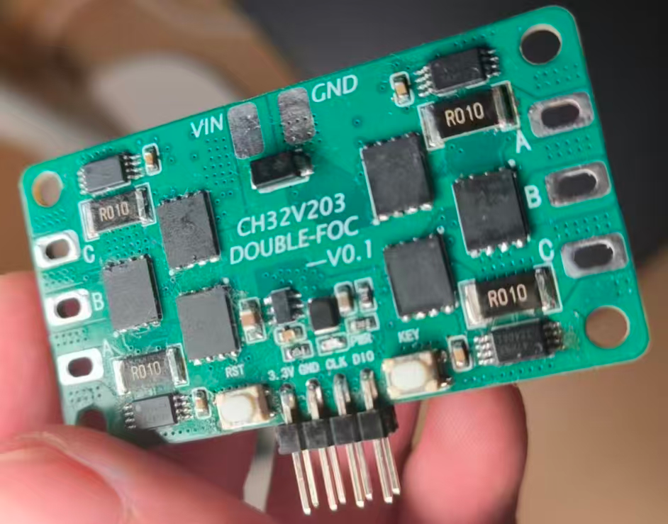
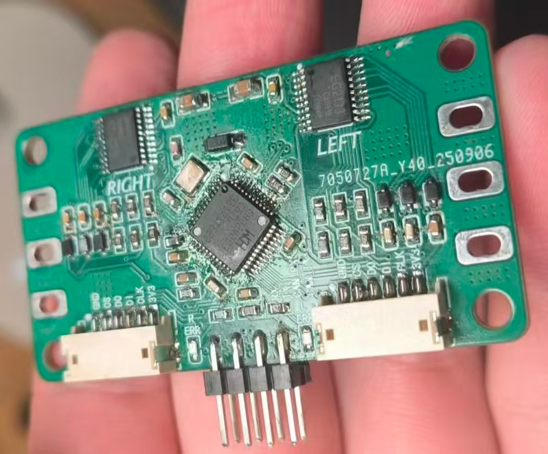
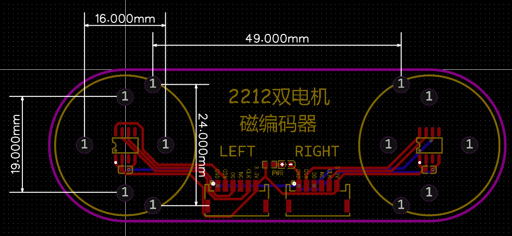
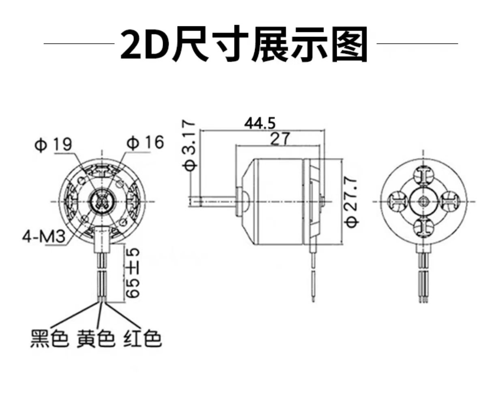
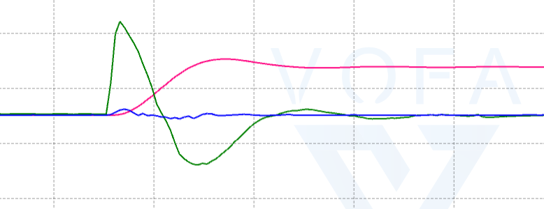

# CH32V203 DOUBLE-FOC



## 工程结构

工程结构如下：

```bash
驱动代码/CH32V203C8T6 FOC双驱/
├── Core/                 RISC-V 核心支持
├── Debug/                WCH 调试/串口打印支持
├── Hardware/             ADC、GPIO、PWM、串口、MT6701、定时器等驱动
├── Ld/                   链接脚本
├── Peripheral/           CH32V20x 外设库
├── Software/             FOC、电机控制、PID、协议、电流与电池模块
├── Startup/              启动文件
├── User/                 main 与中断入口
├── Double_FOC.wvproj     MounRiver Studio 工程
├── Double_FOC.launch     OpenOCD 调试启动配置
├── 引脚定义.txt          引脚说明（使用前请核对已知冲突）
└── 通讯格式.txt          串口协议说明

硬件原理图和PCB/          PCB 工程文件
```

## 硬件电路

下面放出PCB的图片：


本次的硬件选型和传统的FOC略有不同，传统的栅极驱动是FD6288，本工程选择了EG2133，这样做的好处是不需要高级定时器的互补输出就可以用一个定时器PWM输出控制上下桥两个MOS管，节省引脚数量并且不用高级定时器。然后MOS管使用了二N合一管，减少了焊接难度，一路驱动只要焊接3个MOS。支持的额定输入电压是12V，实际支持4.5V~17V的输入电压。

双电机编码器板子：



电机选型是新西达A2212电机：



## 功能概览

- 本项目为双路有感(磁编)FOC驱动，使用CH32V203单片机，引脚和算力资源均已榨干。

- 支持速度环，角度环，角度速度环。

- 搭载电流检测器，支持电流环，电流+速度环，电流+角度环，电流+速度角度环。

- 支持SPWM，SVPWM-7，SVPWM-5。

- 支持双路电机，可以选择只使能左电机或者右电机.

- 支持电池电压检测。

- 支持电池欠压保护，堵转保护，磁编错误保护。

- 支持数据回传，推荐配合Vofa+进行图像可视化。

  

- 自动校正电机机电数。

- 使用串口USART进行电机控制，具体协议见txt文档里面内容。CAN通信目前还不支持。

## 串口协议

串口参数：460800 baud、8 数据位、无校验、1 停止位（8-N-1）。控制帧为二进制格式，固定 6 字节：

| 字节 | 内容 |
| --- | --- |
| 0 | 帧头 `0xA5` |
| 1-2 | 左电机目标值，有符号 16 位二进制补码，高字节在前 |
| 3-4 | 右电机目标值，有符号 16 位二进制补码，高字节在前 |
| 5 | 校验和：字节 0 至 4 相加后保留低 8 位 |

接收端校验帧头和校验和；校验失败时丢弃一个字节，再继续搜索有效帧。两个目标值的解释由 `driver_config.h` 中的 `FOC_MODE` 决定：

| 模式 | 目标值含义 |
| --- | --- |
| `OPEN_LOOP_MODE` | 有符号占空比指令，源码直接写入 `u_q_duty`；工程注释约定 0-10000 对应 0-100%，实际输出还受调制及限幅影响 |
| `VECOCITY_LOOP_MODE`、`VECOCITY_CURRENT_LOOP_MODE` | 速度，单位 RPM；速度目标受 `VECOCITY_LIMIT` 限幅 |
| `ANGLE_LOOP_MODE`、`ANGLE_VECOCITY_LOOP_MODE`、`ANGLE_CURRENT_LOOP_MODE`、`ANGLE_VECOCITY_CURRENT_LOOP_MODE` | 磁编码器角度计数。14 位编码器一圈为 0-16383 |
| `I_Q_LOOP_MODE` | q 轴电流，单位 mA |
| `I_D_LOOP_MODE` | d 轴电流，单位 mA |

每个目标字段范围为有符号 16 位整数（-32768 至 32767）。例如，速度模式下左电机目标 `+1000 RPM`、右电机目标 `-1000 RPM`：

```text
A5 03 E8 FC 18 A4
```

电流目标同样使用 mA，例如 `1000` 表示 `1 A`。当前串口解析对纯 `I_Q_LOOP_MODE`、`I_D_LOOP_MODE` 目标没有额外的目标值限幅；使用时应自行保证指令处于电机和驱动器允许范围内。

数据回传为 ASCII 文本，以逗号分隔、CRLF 结尾；字段按以下顺序输出，关闭的项目不占字段：角度、滤波速度、传感器原始电流 `i_a/i_c`、`u_q_duty`、滤波 `i_q/i_d`、电池电压。开关分别为 `DATA_PRINTF` 总开关，以及 `ANGLE_PRINTF`、`VECOCITY_PRINTF`、`CURRENT_SENSOR_PRINTF`、`U_Q_PRINTF`、`I_Q_I_D_PRINTF`、`BATTERY_PRINTF`。

当前工程默认仅启用左电机，回传角度和滤波 `i_q/i_d`，因此默认每行字段为：`左电机角度,左电机i_q,左电机i_d,0`。角度单位为编码器计数，电流单位为 mA；电池回传值（启用 `BATTERY_PRINTF` 时）为电压乘以 1000，即 mV。末尾的 `0` 是固定结束字段。回传由 TIM3 中断调用，周期配置目标为 1 ms。修改电机使能或回传宏后，字段数量和顺序会变化，上位机解析也要同步调整。

## 使用方法

安装好电机之后，接上编码器，上电观察输出电压和电源指示灯是否正常。测试能否烧录。

该无刷驱动的使用方法如下：

1. 安装与该工程兼容的 MounRiver Studio（工程生成文件标记 MRS 1.9.2）。在 MounRiver Studio 中导入 `驱动代码/CH32V203C8T6 FOC双驱/Double_FOC.wvproj`，编译下载代码（烧录设置不能设置为全片擦除）。第一次使用的时候(这时候芯片flash里面没东西)记得在driver_config.h里面把FIRST_USE改为YES，烧录程序(烧录程序配置不能设置为全片擦除),然后再把FIRST_USE改为NO后再烧录回去即可。

2. 按下KEY按钮进行校正，可以配合串口查看打印输出是否正确。

3. 然后再driver_config.h里面选择自己想要运行的模式和配置的电机参数(使用电流环一定要使能电流传感器)。编译后烧录代码。

4. 上电后按RESET（如果出现异常的话）。可以在上电的时候烧录，但是建议按下RESET让电机停止后烧录。

5. 观察电机运行效果，可以配合串口数据进行调试，调参。

## AI辅助发现的原有代码错误

以下整理自电流环、ADC/PWM 时序和角度/速度环排查对话，修正状态于 2026-10-12 对照当前源码核查。“已修正”表示代码已落实对应修改，不代表所有控制模式均已完成板上验证。文件位置均相对于 `驱动代码/CH32V203C8T6 FOC双驱/`。

### 最初发现的六项问题

| 原有问题 | 影响及示例 | 当前修正情况 | 文件位置 |
| --- | --- | --- | --- |
| 圆限幅混用有符号与无符号运算 | 模长 `sum` 为 `uint32_t`，负电压指令参与无符号除法后可能变成很大的正数。例如 `uq=-3000、ud=3000` 时，原结果约为 `+1009589`，正确结果应约为 `-2896`。 | 已修正：平方和使用 `uint64_t`，缩放乘除使用有符号 `int64_t`，保留轴方向；模长向上取整，避免缩放后越过圆限幅。 | `Software/foc.c` |
| dq 电流变换归一化系数少了约两倍 | 查表幅值为 1000，原两相公式除以 1732，反馈约为常规幅值不变变换的一半。电角度为 0、`Ia=1000mA、Ic=-500mA` 时，原 AC 公式得到 `Id≈500mA`，应约为 `1000mA`。 | 已修正比例：两相公式分母改为 866，三相公式分母由 3000 改为 1500。采样极性、相序及编码器零点仍需实测确认。 | `Software/inline_current.c` |
| PI 积分每步丢弃小数，形成死区和正负不对称 | 原代码先右移再累加。`Ki=0.008` 转为 524 后，持续 `+100mA` 误差的稳态每步积分增量为 0；算术右移下，`-100mA` 却为 -1。 | 已修正：使用 `int64_t integral_acc` 保留积分小数，按相同尺度限幅，仅生成输出时除以 `131072`，采用向零截断。 | `Software/pid.c`、`Software/pid.h` |
| ADC 启动转换后立即读取，且电池采样会额外触发 | 未等待整组 DMA 完成，可能读到上一轮或不同批次混合的数据；电池读取干扰电流采样节奏。 | 已修正读取流程：运行时由控制中断统一启动扫描，检查整组 DMA 完成后发布独立快照；两路电流和电池读取已发布结果。控制中断不阻塞等待，通常使用前一控制周期触发的数据；电流模式缺帧时跳过 PI 并输出零相间电压。PWM 硬件同步尚待完善。 | `Hardware/driver_adc.c`、`Software/motor_control.c`、`Software/inline_current.c` |
| PWM 比较值重复偏置、缩放，且三相更新缺少预装载 | FOC 已输出约 `0～4000` 的比较值，底层再执行 `(4000+duty)/2`，导致相间电压幅度减半；逐相立即写入可能影响当前 PWM 周期。 | 已修正：直接写入比较值，TIM2/TIM4 三个通道均启用预装载；写入整组三相值期间暂时禁止更新事件，完成后恢复原状态，使其在后续更新事件统一生效。 | `Hardware/pwm_output.c` |
| 串口负目标值解析错误 | 原写法在拼接前转换高字节，不能完成整体 16 位符号解释；`FF 9C` 应为 -100，却得到 65436。 | 已修正：先用 `uint16_t` 拼接，再整体转为 `int16_t`。纯电流模式的目标电流限幅仍未补齐。 | `Software/motor_uart.c` |

**只有积分限幅，输出饱和后仍继续积分。**[pid.c (line 76)](E:/Bi记/电机驱动/无刷电机驱动/自己的项目/CH32V203 DOUBLE-FOC/驱动代码/CH32V203C8T6 FOC双驱/Software/pid.c:76) 中，积分没有根据最终输出是否饱和决定暂停。

用当前速度电流环参数复算：持续 `+2000 RPM` 误差，约 15ms 后积分达到 `+2000mA`；随后误差变为 `−100 RPM`，输出仍为：

```
+1800 → +1792 → +1784 mA …
```

**已经超速，却仍维持正向转矩一段时间。** 这会加重超调，也可能参与角度三环的往复振荡。建议增加条件积分：输出饱和且误差继续推动其饱和时停止积分，允许反向积分退出饱和。该问题已经解决。

### 后续排查发现的问题

| 原有问题 | 影响 | 当前修正情况 | 文件位置 |
| --- | --- | --- | --- |
| ADC 实际时钟与注释不符，超出规格范围 | 在原 144MHz 系统配置下，APB2 未分频，ADC 六分频实际为 24MHz，并非注释中的 12MHz。 | 已修正当前 144MHz HSE 配置：APB2 二分频为 72MHz，ADC 六分频为 12MHz。TIM1 因 APB 分频后的定时器倍频机制仍为 144MHz，原 20kHz 控制周期无需随之修改。 | `User/system_ch32v20x.c`、`Hardware/driver_adc.c` |
| 串口相关中断可能阻塞电流环 | TIM3 内阻塞式打印原先与 TIM1 同抢占级，USART1 接收优先级又高于 TIM1，可能延迟 50μs 周期的控制任务。 | 已调整：TIM1 抢占优先级为 0，TIM3 和 USART1 为 1。用户反馈间歇噪声可能与该阻塞有关；打印本身仍是阻塞式，不能据此认定所有噪声均已解决。 | `Hardware/pwm_output.c`、`Hardware/serial.c`、`Debug/debug.c` |
| 三环角度模式未纳入串口目标解析 | `ANGLE_VECOCITY_CURRENT_LOOP_MODE` 不在原角度解析分支内，串口不能正常更新该模式的目标角度。 | 已修正：加入角度目标解析分支。 | `Software/motor_uart.c` |
| 速度方向与角度方向定义不一致 | 原速度固定取负号，角度却使用 `rotation_direction`；某些方向配置下，两者符号不一致。 | 已修正：角度累计和速度计算统一使用经过 `rotation_direction` 修正的 `angle_delta`。 | `Software/motor_control.c` |
| 速度换算未使用实际观测周期，整数滤波丢失低速信息 | `20000/6000` 的整数分频得到 3，实际观测频率约为 6666.7Hz；按 6000Hz 换算并提前截断系数会产生比例误差，整数滤波还会抑制较小速度反馈。 | 已修正：按 `F_OPEN/VECOCITY_OB_COUNT` 的实际周期进行 64 位换算，使用 Q16 滤波状态保留小数，输出时再转换为整数 RPM。 | `Software/motor_control.c`、`Software/motor_control.h` |
| SVPWM 零矢量分支与邻近指令的共模占空比不连续 | 原默认分支输出三相全 0，邻近的小指令在七段式调制下接近三相 50%，可能引入共模跳变；两者理想相间电压均为零，不能直接等同于转矩冲击。 | 已调整：默认分支三相统一输出计算得到的 `svpwm.ta`，七段式零指令对应居中占空比。 | `Software/foc.c` |

### 尚待处理或验证的事项

- **纯电流目标限幅**：`I_Q_LOOP_MODE`、`I_D_LOOP_MODE` 的串口目标目前直接赋值，需结合电机及驱动能力补充范围限制；PI 输出限幅不等于目标电流限幅。
- **采样与 PWM 同步**：整帧 DMA 发布解决了数据完整性问题，但目前仍由控制中断软件触发 ADC，尚未建立固定 PWM 相位的硬件触发采样。
- **积分参数与饱和处理**：当前 `Ki` 是每次调用的离散积分系数，未显式乘控制周期不必然是错误；改变环路频率时需重新换算。现有积分限幅也不等于针对最终电压饱和的完整抗积分饱和处理。
- **修正电流换算注释**：`inline_current.c` 中仍有旧的 `38>>16` 说明。`38/65536` 近似 `1/1732`，不再对应当前两相公式的 `1/866`。
- **角度附近振荡仍需定位**：空载振荡、加负载后减小是观察现象，尚不能确定由限幅、增益、时延或阻尼中的哪一项主导。角度到电流采用 P 环本身不是代码错误；增加速度阻尼属于控制方案和调参选择，不列为已确认的原有错误。
- **速度模式回传电流为 0 尚未确认是故障**：需区分实际 `i_q/i_d`、电流目标 `i_q_set` 和串口末尾固定字段 `0`；电压型速度模式不使用电流目标，不能仅凭该值判断采样异常。

## 当前待完善项

- 要控制上电顺序,先上3.3V单片机电源后再上12V总电源。补充经硬件验证的输入电压、电流限制、功率器件型号、散热要求和接线图。需要进一步更改硬件。
- 继续优化编码器读取速度与 FOC 计算效率。
- 增加CAN通信内容。
